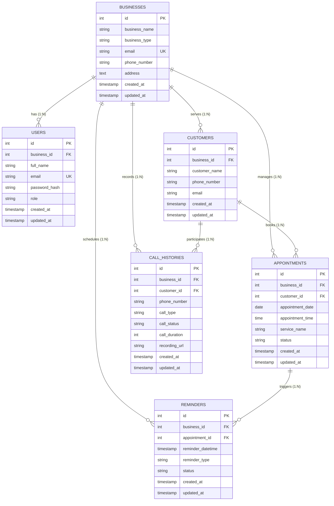

# AI Voice Assistant - Architecture & System Design

## 1. Executive Overview

**AI Voice Assistant** is an enterprise-grade, multi-business SaaS platform engineered to deliver automated, low-latency AI-powered voice receptionist capabilities. The platform supports specialized industry verticals including:

- **Hospitals & Clinics**: Patient triage, department routing, doctor consultation scheduling, inquiry answering.
- **Hotels & Hospitality**: Room booking inquiries, concierge requests, amenities scheduling, front-desk offloading.
- **Salons & Spas**: Stylist appointment booking, service catalog pricing, slot management.
- **Automobile Service Centres**: Service booking, repair status lookups, estimate queries, roadside dispatch assistance.
- **Real Estate Agencies**: Property inquiry qualification, site visit scheduling, agent handover.

---

## 2. Architectural Layers

The backend follows a clean, modular, layered architecture designed for strict separation of concerns, testability, and horizontal scalability:

```
┌────────────────────────────────────────────────────────┐
│                   Client Layer                         │
│   (React + Vite Web App / Twilio Telephony Webhook)    │
└───────────────────────────┬────────────────────────────┘
                            │ HTTPS / WSS
┌───────────────────────────▼────────────────────────────┐
│                    API Gateway / Router                │
│             FastAPI App (CORS, Rate Limiting)          │
│                  prefix: /api/v1                       │
└──────────────┬──────────────────────────┬──────────────┘
               │                          │
┌──────────────▼────────────┐  ┌──────────▼──────────────┐
│     Dependency Injection  │  │  Core Infrastructure    │
│  (DB Session, Auth, RBAC) │  │  (Config, Security,     │
│       app/api/deps.py     │  │   Logging, Error Handler│
└──────────────┬────────────┘  └─────────────────────────┘
               │
┌──────────────▼─────────────────────────────────────────┐
│                    Service Layer                       │
│    (Business Logic, Call Orchestration, Appointments)  │
│                   app/services/                        │
└──────────────┬──────────────────────────┬──────────────┘
               │                          │
┌──────────────▼────────────┐  ┌──────────▼──────────────┐
│       ORM & Persistence   │  │  External Integrations  │
│  SQLAlchemy 2.0 Engine    │  │  (OpenAI Realtime API,  │
│  PostgreSQL Database      │  │   Twilio Voice/SMS,     │
│  app/database & models/   │  │   Google Calendar, etc.)│
└───────────────────────────┘  └─────────────────────────┘
```

---

## 3. Technology Stack Justification

| Technology | Role | Justification |
| :--- | :--- | :--- |
| **FastAPI** | REST API & WebSocket Server | High-performance asynchronous execution, native OpenAPI documentation, automatic validation via Pydantic. |
| **SQLAlchemy 2.0** | Database ORM & Session Pool | Industry standard with type-safe Mapped models, robust connection pooling, transactional consistency. |
| **PostgreSQL** | Primary Relational Storage | ACID-compliant, supports relational multi-tenant models, JSONB for dynamic prompt templates, reliable indexing. |
| **Pydantic Settings** | Environment Configuration | Strict typing, validation of environment variables on startup, central single source of truth. |
| **Pytest & TestClient** | Automated Verification | Fast, deterministic integration and unit testing with mock isolation and in-memory test databases. |

---

## 4. Database Schema & Entity-Relationship Model (Phase 2)



### Relationship & Integrity Rules:
1. **Multi-Tenant Ownership**: `businesses` is the root aggregate entity. Deleting a business initiates a `CASCADE` delete removing all associated users, customers, appointments, reminders, and call histories.
2. **Customer Appointments**: Deleting a customer deletes their appointments via `CASCADE`.
3. **Audit Trail Preservation**: Deleting a customer sets `call_histories.customer_id` to `NULL` (`ondelete="SET NULL"`), ensuring inbound telephony logs, recordings, and duration metrics remain preserved for business accounting and analytics.
4. **Appointment Reminders**: Deleting an appointment cascades to delete its linked pending/sent reminders (`CASCADE`).

---

## 5. Multi-Tenant Data Isolation Strategy

Each business tenant registered on the platform will be uniquely identified by a `tenant_id` (UUID). Future models will incorporate a composite tenant scoping:

- **Tenant Isolation**: Every database query in services will filter by `tenant_id` to guarantee zero cross-tenant data leakage.
- **Custom Prompts & Knowledge Base**: Each tenant configures business hours, FAQs, services, and voice persona presets stored as tenant configurations.
- **Dedicated Phone Numbers**: Inbound Twilio phone numbers map directly to specific tenant UUIDs.

---

## 5. Telephony & Realtime AI Flow (Future Stage Roadmap)

When telephony is connected in later stages, the execution pipeline will be:

```
Caller (PSTN)
   │
   ▼
Twilio Voice Gateway
   │ WebSocket Media Stream
   ▼
FastAPI Streaming Gateway (backend/app/api/routes/calls.py)
   │ Bidirectional Audio Streaming
   ▼
OpenAI Realtime API (Audio In / Audio Out)
   │ Function Calling / Tool Calling
   ▼
Voice Assistant Service Layer (app/services/appointments.py)
   │
   ├─► Query Availability / Create Reservation (PostgreSQL)
   └─► Sync Event (Google Calendar API)
```

---

## 6. Observability & Health Checks

- **Application Health (`GET /api/v1/health`)**: Inspects service process status, active version, and environment.
- **Database Health (`GET /api/v1/health/database`)**: Executes an active `SELECT 1` ping across the connection pool, reporting HTTP 200 on success and HTTP 503 Service Unavailable with diagnostic data upon failure.
- **Structured Logging (`app/core/logging.py`)**: Standardized timestamps, log level tagging, and module origin for containerized log shippers (Fluentbit, Datadog, CloudWatch).
